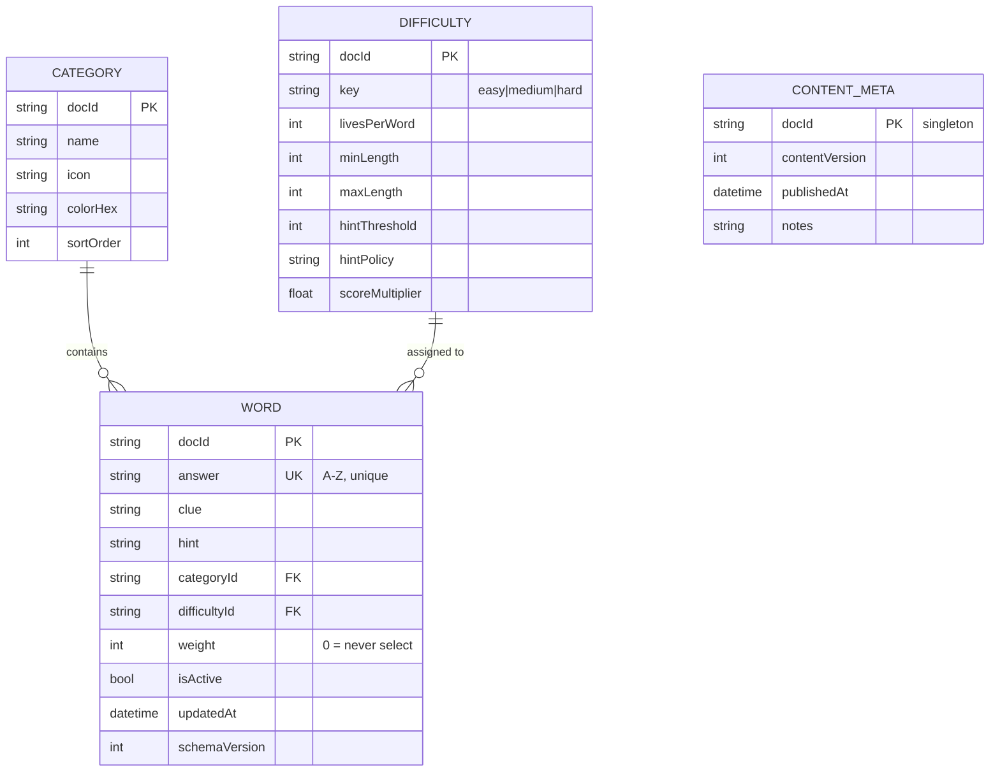

# Firestore Schema — HANGARoo content backend

**Issue:** #31 (Story 2.2, EPIC #2) · **Deployment:** `firebase deploy --only firestore:rules,firestore:indexes`
**Related:** [`docs/WORD_CONTENT_POLICY.md`](WORD_CONTENT_POLICY.md) (the authored-content rules this schema enforces)

This document is the schema **of record**. The machine-readable artifacts live next to it:

| Artifact | Path | Deployed by |
|---|---|---|
| Security rules | `firebase/firestore.rules` | `firebase deploy --only firestore:rules` |
| Indexes | `firebase/firestore.indexes.json` | `firebase deploy --only firestore:indexes` |
| Seed tooling | `scripts/seed-firestore.py` | manually, from a machine holding the service account |

---

## Collections



| Collection | Doc ID | Purpose |
|---|---|---|
| `words` | `{answer lowercase}-{difficultyId}` (e.g. `gravity-medium`) | the word bank; the only collection the game queries |
| `categories` | category key (e.g. `space`) | display metadata for the `ShowCategory` setting |
| `difficulties` | difficulty key (`easy` / `medium` / `hard`) | tunable run rules — the values Remote Config (#40) will eventually override |
| `contentMeta` | `singleton` | `contentVersion` counter so clients detect a content publish |

> **Naming note.** The rules sketch in #31 matched `/content/{docId}`; the query
> contract in the same issue says `collection: words`. This schema standardizes
> on **`words`** everywhere, so rules, indexes, seed tooling and the client all
> name the same collection.

## Field conventions

| Field | Rule | Rationale |
|---|---|---|
| `answer` | `[A-Z]+`, uppercase, **unique across the collection** | the win condition; non-letters make a word unwinnable |
| `clue` | non-empty, ≤ 60 chars, must not contain the answer | a clue containing the answer is broken content |
| `hint` | non-empty, must not restate the clue | validated by the same `WordValidator` rules as the local build |
| `categoryId` | must reference an existing `categories` doc | the `ShowCategory` setting depends on it |
| `difficultyId` | `easy` \| `medium` \| `hard` (string keys, **never** 0/1/2 ints) | the primary query key; int ids would silently reinterpret every document if the C# enum were ever reordered |
| `weight` | relative selection weight; `0` = never selected | lets a word be soft-disabled without editing `isActive` |
| `isActive` | soft-delete | never hard-delete content that may be in a player's history |
| `updatedAt` | server timestamp, **written only when the document actually changes** | lets the client skip re-parsing unchanged docs; also what makes the seed idempotent |
| `schemaVersion` | int, bumped on shape changes | client can migrate old documents in place |

## The one query the client runs

```
collection: words
where: difficultyId == {difficulty}, isActive == true
order by: weight desc
limit: 200
```

This needs the composite index `(difficultyId ASC, isActive ASC, weight DESC)`
declared in `firebase/firestore.indexes.json`. Single-field indexes are created
automatically by Firestore; the composite one is not — **the first developer to
run the query without it hits a hard runtime failure**, so it deploys with the
rules, not later.

## Security rules

Word content is **public and read-only from the client**. No client may ever
write content — a compromised or careless build must not alter what every player
sees. Content edits go through the Firebase Console or the CI-seeded admin
script (`scripts/seed-firestore.py`) using a service account.

User progress (EPIC #3, #34–#37) lives under `users/{userId}` and is
owner-only: `request.auth != null && request.auth.uid == userId`. A negative
test for both halves lives in `firebase/tests/rules.test.js` and runs against
the Firestore emulator (see below).

## Content versioning

`contentMeta/singleton` carries:

- `contentVersion` (int) — incremented by exactly 1 per publish that changed
  at least one document;
- `contentHash` (string) — SHA-256 of the canonical content, so a re-seed of
  identical content is a **no-op** rather than a version bump;
- `publishedAt` (server timestamp), `notes` (free text).

A client polls `contentVersion` (cheap single read, no index) and re-fetches the
word bank only when it moves.

## Seed tooling

```
words.json ──► scripts/seed-firestore.py ──► Firestore
                   │  1. run the SAME validation as CI
                   │     (imports scripts/validate-content.py)
                   │  2. build docs with deterministic doc IDs
                   │  3. diff against what is already deployed
                   │  4. write only new/changed docs (batched)
                   └─► contentMeta/singleton bumped only on change
```

- **Validation is shared, not mirrored.** The seeder imports
  `scripts/validate-content.py` (the CI gate) and refuses to write anything if
  it reports a problem — the seed path cannot drift from the local build.
- **Idempotent by construction.** Doc IDs are deterministic
  (`{answer}-{difficulty}`), and every document is compared field-by-field
  against the deployed copy before writing. Running the seed twice against an
  unchanged `words.json` performs **zero writes and zero version bumps**.
- **Credentials never enter the repository.** The service account is passed via
  `GOOGLE_APPLICATION_CREDENTIALS` (the standard env var) or found by
  `google-application-credentials.json` next to no tracked path — the seeder
  refuses to run without one, except against the emulator.
- **Default is dry-run.** `--push` is required to write anything.

> **Deviation from the #31 sketch, deliberate.** The issue proposed an "Editor
> script using the Admin SDK". There is no Admin SDK for Unity/C# — Firebase
> Admin SDKs exist for Node, Python, Java and Go only. The Python seeder above
> is the same design with a runtime that actually has the Admin SDK, and it
> runs unattended in CI, which a menu item cannot.

### Usage

```bash
# Dry run: validate + print the plan, touch nothing.
python3 scripts/seed-firestore.py

# Real publish (needs the service account).
export GOOGLE_APPLICATION_CREDENTIALS=/path/to/service-account.json
python3 scripts/seed-firestore.py --push

# Against the emulator (no credentials needed).
FIRESTORE_EMULATOR_HOST=localhost:8080 \
  python3 scripts/seed-firestore.py --push --project demo-hangaroo
```

Difficulty documents are sourced from the `DifficultyConfig` assets
(`Assets/Settings/Difficulty/*.asset`) at seed time, so the deployed rules
cannot drift from the values the game itself ships.

## Emulator tests for the rules

`firebase/tests/rules.test.js` covers the two rules guarantees that matter:

1. **positive** — a signed-out client can read `words`;
2. **negative** — a signed-out (or wrong-user) client **cannot** write `words`
   or another user's `users/{userId}` document; the owner can write their own.

Run them entirely offline via the emulator (Java is required):

```bash
scripts/test-firestore-rules.sh
```

This script is designed to become a required CI check in #39 (`emulators:exec`
gives a non-zero exit on failure, same contract as `scripts/run-tests.sh`).

## Deploy runbook

1. `firebase use <project-id>` (one-time per machine).
2. `firebase deploy --only firestore:rules,firestore:indexes`.
3. `scripts/seed-firestore.py` (dry-run), review the plan, re-run with `--push`.
4. Verify: run the client query for each difficulty — no index error, ≥ 60
   active words per band.

Deployment itself is an owner action: it needs the Firebase project's
credentials, which by design are not in this repository.
